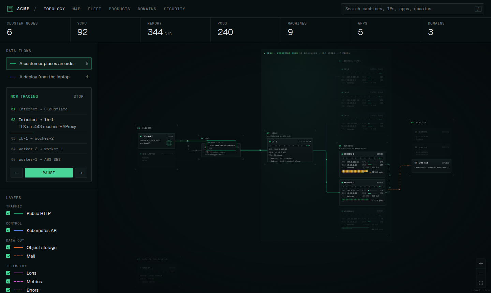
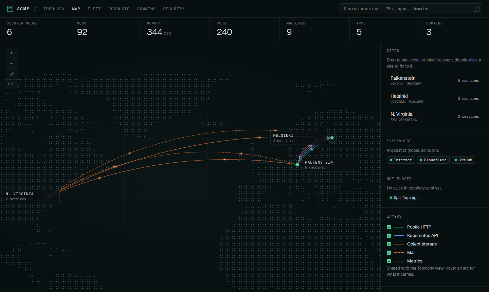
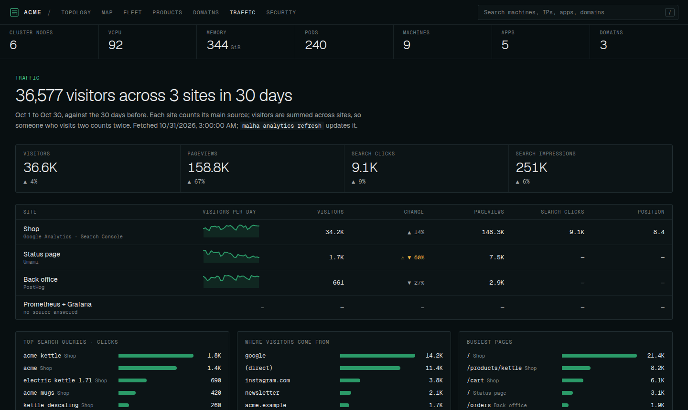

# Malha.sh

Your infrastructure as one YAML file, drawn as a live map.

*Malha* is Portuguese for mesh. You describe your machines, sites, links, apps, domains and data flows in a single `topology.yaml`. `malha dev` draws it in the browser and reloads the page every time you save. The same file is checked in CI, published as a static site, scanned for vulnerable dependencies, and kept in sync with your registrar and DNS host.



| Tab | What it shows |
| --- | --- |
| Topology | Machines grouped in zones, links as animated packets in the direction the data moves, playable data flows, and app traces that light up the path from a domain to its pods and databases. |
| Map | Every site on a dot-matrix world map, with arcs for the traffic between places. The busiest site gets an inset of its datacenters. Pan, zoom, fly to a site. |
| Fleet | One rack per provider, machines as sleds sized by their CPU. |
| Products | Apps against workers: pods per node, database replicas, and databases that live on a single node. |
| Domains | Every registered domain: registrar, DNS, expiry with days left, a renewal calendar, and what each domain serves. |
| Traffic | Every site's visitors and search traffic in one place, from Umami, Google Analytics, PostHog and Search Console: trends, changes, top pages, referrers and queries. |
| Security | Known vulnerabilities in the dependencies of every app, from a `malha scan`. |



[Plugins](#plugins) extend it: `malha kubernetes import` drafts nodes, apps and hostnames from a cluster, and the same plugin shows live CPU, memory and pods in the viewer. Plugin code runs sandboxed and asks before it touches anything.

`malha check` turns what the map knows into a short list of what needs a person (domains about to expire, full nodes, databases on one machine, critical vulnerabilities) and, with a notifier plugin, posts what is new to Discord or Slack.

It is a local tool. Nothing is uploaded anywhere unless you run `scan` or a plugin, and each says exactly what it sends (see [Privacy](#privacy)).

## Install

Malha needs Node 20.19 or newer.

```bash
npm install -g malha        # or, without installing: npx malha <command>
```

To work on Malha itself, see [Developing Malha](#developing-malha).

## Quickstart

```bash
malha init infra                  # infra/topology.yaml, infra/topology.schema.json, .malha/ in .gitignore
malha dev infra/topology.yaml     # http://127.0.0.1:5199, reloads when you save
```

To start from a full example instead: `malha init infra --example` writes the fictional Acme setup this repo uses for its own tests.

Editors with the YAML language server (VS Code, Cursor) read `topology.schema.json` from the first line of the file and autocomplete every field. After upgrading Malha, run `malha schema infra` to refresh it.

## Commands

`[file]` defaults to `./topology.yaml`.

| Command | What it does | Options |
| --- | --- | --- |
| `malha init [dir]` | Writes a commented starter `topology.yaml` and the schema, and adds `.malha/` to `.gitignore`. | `--example` for the Acme example, `--force` to overwrite |
| `malha dev [file]` | Serves the viewer for that file. Saving the file, or a new scan, reloads the page. An invalid file shows its errors in the page and the terminal. Live plugins refresh it. | `--port 5199` (moves to the next free port if taken), `--host 127.0.0.1`, `--no-plugins` |
| `malha validate [file]` | Checks the schema, every cross-reference and the [standards](#what-validate-checks). Exits 1 on errors. | `--strict` also fails on warnings |
| `malha build [file]` | A static site with the data inside `index.html`, for any static web server. | `--out malha-site`, `--no-scan` |
| `malha scan [file]` | Scans the dependencies behind every app. See [Dependency scan](#dependency-scan). | `--code-dir <dir>` (or `$MALHA_CODE_DIR`), `--app <id>` (repeatable), `--no-fetch`, `--offline` |
| `malha analytics [refresh\|detect] [file]` | Traffic per app, from the analytics plugins. See [Traffic](#traffic). | `--days 30`, `--timezone`, `--dry-run`, `--yes` |
| `malha check [file]` | What needs a person, by area. Exits 1 on critical findings. See [Checks and alerts](#checks-and-alerts). | `--live`, `--notify`, `--digest`, `--json`, `--fail-on critical\|warning\|none`, `--vulns critical\|high\|medium` |
| `malha schema [dir]` | Writes `topology.schema.json` for editor autocomplete. | |
| `malha <plugin> <command> [file]` | Runs a plugin's command and shows the changes it proposes as a diff. See [Plugins](#plugins). | `--dry-run`, `--yes` (write without asking), `-- <plugin args>` |
| `malha plugin add\|list\|allow\|revoke\|remove\|log\|new` | Manages the project's plugins and your approvals. | See [docs/plugins.md](docs/plugins.md) |

`malha validate` in CI:

```yaml
- run: npx malha validate infra/topology.yaml --strict
```

## The file

`topology.yaml` holds nothing secret. Leave out keys, tokens and passwords. Public IPs and hostnames are fine if your repo is private.

Ids are lowercase (`a-z`, `0-9`, `-`). Nodes and zones share one id space, because a link can point at either. Only `version`, `meta`, `zones` and `nodes` are required; every other section is optional, and the matching tab stays empty without it.

### `nodes`: one entry per machine or service

```yaml
- id: w1
  name: worker-1
  kind: worker              # users | workstation | proxy | control-plane | worker | server | saas
  zone: workers             # where it sits on the Topology canvas
  status: active            # active | idle | degraded | planned | retired
  provider: hetzner         # groups machines into racks on the Fleet tab
  site: falkenstein         # its pin on the Map tab; a list for multi-region services
  host: worker-1.acme.example
  addresses: { public: 203.0.113.21, mesh: 10.10.0.21 }   # any keys
  networks: [internet, mesh]  # members of an overlay network get an outline around them
  ssh: { port: 22, user: ops }
  hardware: { model: AX102, cpu: 32, memory_gib: 128, max_pods: 110, disks: [2 × 1.9 TB NVMe RAID1] }
  usage: { cpu_pct: 14, memory_pct: 38, pods: 94, sampled: 2026-10-01 }
  runs: [ingress-nginx, node-exporter]
  notes: Anything worth knowing.
  docs: [docs/runbook.md]
```

### `links`: what talks to what

```yaml
- from: workers             # a node id, a zone id, or a list
  to: s3
  kind: storage
  ports: [443]
  via: mesh                 # the network it rides on
  label: Uploads
```

Point `from` and `to` the way the data moves: logs go from the server to the log service, and images go from the registry to the servers. A zone endpoint stands for every node in that zone, so a new machine picks up its zone's links by itself.

Each kind has a colour family and a dash pattern. The four hues were checked together for colour-blind separation; kinds within a family differ by dash pattern and by the label on hover.

| Family | Kinds |
| --- | --- |
| Traffic (green) | `http` |
| Control (blue) | `control` |
| Data out (orange) | `storage` solid, `mail` dashed |
| Telemetry (magenta) | `logs` solid, `metrics` dashed, `errors` dotted |
| Supply (grey) | `ci` solid, `certs` dashed, `dns` dotted |
| Admin (dark grey) | `ssh` |

`certs` and `ssh` start hidden; the layer toggles turn them on.

### `zones`: layout

```yaml
- { id: workers, name: Workers, column: 3 }           # columns left to right
- { id: outside, name: Outside, column: 0, row: 1, stack: horizontal }
```

Zones in the same column and row stack in the order listed. Cards keep the order of `nodes`.

### `sites`: physical places

```yaml
- id: falkenstein
  name: Falkenstein
  region: "Saxony, Germany"
  lat: 50.48
  lon: 12.37
  notes: How you know it is there (latency, the provider's region name, a traceroute).
```

Links between nodes at different sites become arcs on the Map. Links inside a site, between different providers, become lines in that site's inset. Leave `site` out for anycast services and anything you haven't confirmed; those are listed beside the map instead.

Registry data (whois) usually shows a company's headquarters, not its datacenter. Round-trip time from a machine you know is the reliable check: under about 3 ms is the same metro.

### `apps`: what runs where

```yaml
- id: shop
  name: Shop
  category: product         # product | platform | internal | staging
  namespace: shop                         # or a list: [shop, shop-redis]
  domains: [acme.example, shop.acme.example]
  repos: [github.com/acme/storefront]     # git remotes, for malha scan
  pods: { w1: 6, w2: 4 }                  # pods per node
  databases:
    - { name: shop-db, engine: postgres, nodes: [w1, w2] }
  uses: [s3, ses]                         # node ids it talks to
  depends_on: [api]                       # other apps it calls
```

For something outside a cluster, use `host: <node id>` instead of `pods`. `meta.pods_sampled` dates the pod counts.

### `domains`: what is registered where

```yaml
domains:
  checked: 2026-10-01
  list:
    - { name: acme.example, registrar: porkbun, expires: 2027-06-30, auto_renew: true, dns: cloudflare, plan: pro, visitors: 184000, insights: 3 }
```

`registrar` and `dns` are provider ids. You never list what a domain serves: Malha matches every app hostname and machine `host` to its registered domain (`api.acme.example` → `acme.example`, `shop.com.br` keeps three labels).

### `accepted`: findings you live with

```yaml
accepted:
  - { check: single-node-database, subject: staging/staging-db, why: Staging is rebuilt from a dump. }
  - { check: domain-expiry, subject: acme-old.example, why: Letting it lapse., until: 2026-12-31 }
```

`malha check` leaves these out, and says why, until `until` (or for good without it). `subject` is what the finding is about: a domain, a node id, `app/database`, or an advisory id. Leave it out to accept every finding of that check. The checks are listed in [docs/checks.md](docs/checks.md).

### `flows`: walkthroughs

```yaml
- id: order
  name: A customer places an order
  kind: http
  steps:
    - { from: internet, to: lb, label: "TLS on :443 reaches HAProxy" }
    - { from: w2, to: w1, label: "Pod to pod", via: pods }
```

Each step lights the link between its ends, in either direction or through a zone. A step with no matching link draws a dashed hop. A step with `via` rides a network rather than a declared link.

### `providers`, `networks`, `meta`

Providers name who hosts things (`datacenter | cloud | saas | home`). Networks give CIDRs; the first `overlay` network that nodes list in `networks` is drawn around its members on the Topology tab. `meta.name` titles the page.

### What `validate` checks

**Errors** (exit 1):
- anything the schema rejects, named by item and field, for example `nodes[8] (w1).hardware: unknown field "memory_gb"`;
- duplicate ids;
- references to zones, providers, sites, networks, nodes or apps that don't exist.

**Warnings:**
- a node above `max_pods`;
- an empty zone;
- a flow step with no link;
- a hostname whose domain isn't listed;
- a domain in use with no tracked expiry, with auto-renew off, or expiring within 30 days.

The viewer also flags a few things on its own: nodes at 80% of `max_pods`, databases on a single node, and domains expiring within 45 days. `malha check` covers the same ground as a list you can act on, schedule and accept.

## Dependency scan

```bash
malha scan infra/topology.yaml --code-dir ~/code
```

How it works:

1. **Finds the clones.** For every repo in `apps[].repos`, it looks under `--code-dir`, up to four levels deep, for a clone whose `origin` matches. When several clones share a remote (worktrees, branch copies), it takes the one named like the repo and outside an `archived/` folder.
2. **Fetches,** so it sees what was pushed.
3. **Reads the lockfiles from the remote's default branch** with `git show`, so local edits and unpushed work don't count. Lockfiles under `examples/`, `docs/`, `test/`, `spec/` and fixtures are skipped.
4. **Runs [OSV-Scanner](https://google.github.io/osv-scanner/) once over all of them.** Supported lockfiles: Bundler, npm, pnpm, Yarn, Bun (`bun.lock`), Go, Python, Composer, Cargo.
5. **Writes `.malha/scan.json` next to the topology file.** `malha dev` reloads when it changes, and `malha build` embeds it.

How it counts:

- Each package and advisory pair counts once per repo, however many lockfiles carry it.
- Severity comes from the CVSS score: 9 and up is critical, 7 high, 4 medium.
- Development-only npm dependencies are counted apart, behind a toggle. Bundler lockfiles don't mark them, so they can't be separated there.
- The fixed version shown is the lowest fix in the range the installed version falls in.

It needs `git` and OSV-Scanner 2:

```bash
go install github.com/google/osv-scanner/v2/cmd/osv-scanner@v2.6.0   # or a release binary; or set $OSV_SCANNER
```

## Checks and alerts

```bash
malha check infra/topology.yaml           # what needs a person, by area; exit 1 on a critical finding
malha check infra/topology.yaml --live    # with the cluster's numbers right now, from live plugins
malha check infra/topology.yaml --notify  # also post what is new or worse to Discord or Slack
```

| Area | Findings |
| --- | --- |
| Domains | Expiring within 30 days (critical within 7 when it serves something); expired; in use with no tracked expiry or with auto-renew off; used but not listed. |
| Nodes | At 80% of `max_pods` (critical at 95%); degraded. |
| Databases | A database whose replicas are all on one node. |
| Dependencies | Critical vulnerabilities from the last `malha scan`, one per advisory across repos (`--vulns high` adds high ones); a scan older than two weeks. |

Accept what you live with in [`accepted`](#accepted-findings-you-live-with). `--notify` sends each finding once, and again when it gets worse (a domain at 30 days, then 14, 7 and 1), plus what was resolved; `--digest` sends everything open. Notifiers are plugins: `malha plugin add discord`, then put the webhook URL in `DISCORD_WEBHOOK_URL` or `~/.config/malha/discord-webhook` (`slack` works the same way).

[docs/checks.md](docs/checks.md) lists every check and level, and how to run it daily: a GitHub Actions workflow, or a timer on your machine.

## Traffic

The Traffic tab puts every site's visitors and search traffic in one place. Plugins read Umami (cloud or self-hosted), Google Analytics 4 and Search Console (one read-only service account), and PostHog (cloud or self-hosted).

```bash
malha plugin add google infra/topology.yaml    # or umami, posthog
malha analytics detect infra/topology.yaml     # finds the trackers on each app's pages; proposes its analytics sources
malha analytics refresh infra/topology.yaml    # the last 30 days, into .malha/analytics.json
```



`malha check` flags sites whose traffic falls by half or stops. Setup for each provider, and what each number means: [docs/analytics.md](docs/analytics.md).

## Domains and DNS

Two plugins keep `domains` in step with your registrar and DNS host, and map DNS onto the rest of the file. They propose changes as a diff, like any plugin, and never remove anything.

```bash
malha plugin add porkbun infra/topology.yaml && malha porkbun sync infra/topology.yaml      # registrar, expiry, auto-renew
malha plugin add cloudflare infra/topology.yaml && malha cloudflare zones infra/topology.yaml   # DNS host and plan
malha cloudflare records infra/topology.yaml   # hostnames for apps, links to machines, records that point at nothing you run
```

| Plugin | Credentials |
| --- | --- |
| `porkbun` | `PORKBUN_API_KEY` and `PORKBUN_SECRET_API_KEY`, or `~/.config/malha/porkbun-api-key` and `porkbun-secret-api-key`. API access must be on for the account. |
| `cloudflare` | `CLOUDFLARE_API_TOKEN`, or `~/.config/malha/cloudflare-token`. Zone → Zone → Read, plus Zone → DNS → Read for `records`. |

`cloudflare records` follows every A, AAAA and CNAME record to the machine it reaches. A name no app lists goes to the app with the closest names (`beta.shop.acme.example` to the app that has `shop.acme.example`); a machine that names reach without an HTTP link gets one. It also reports records that point at retired machines (remove them before someone else gets the address), at addresses no machine in the file has, and app hostnames with no record. `malha domains sync`, before 0.4.0, did the first two; it now points here.

## Plugins

A plugin reads something Malha doesn't know about (a cluster, a cloud account, an API) and proposes changes to `topology.yaml`, feeds live numbers to the open viewer, or delivers `malha check` findings. These ship with Malha: `kubernetes`, `porkbun`, `cloudflare`, `umami`, `google`, `posthog`, `discord` and `slack`.

```bash
malha plugin add kubernetes infra/topology.yaml   # review what it may do; adds it to malha.plugins.json
malha kubernetes import infra/topology.yaml       # usage, new nodes, pods per app, hostnames; you review the diff
malha dev infra/topology.yaml                     # and the viewer shows live CPU, memory and pods per node
```

Plugin code runs in a separate Node process that can read only its own folder, with no environment, no child processes and no network of its own (cut by bubblewrap, `unshare`, `sandbox-exec` or Node's network permission, whichever the machine has). Everything else it wants (running `kubectl get nodes`, fetching an API, reading a token) is a request: Malha refuses anything the plugin's `malha-plugin.json` doesn't declare, and asks you about the rest, in the terminal or in the browser, the way Claude Code asks before it runs a command: yes, yes and don't ask again, or no. A plugin never writes files; it returns changes, and Malha writes them only after showing you the diff.

[docs/plugins.md](docs/plugins.md) covers using plugins, exactly what the sandbox does and doesn't stop, writing your own (`malha plugin new`), and the `kubernetes` plugin's reference.

## Hosting a build

`malha build infra/topology.yaml --out site` writes plain static files with relative paths. Serve them from any web server, an object store behind auth, or `npx serve site`. Browsers won't run the module scripts from `file://`, so the folder can't be opened by double-click. The page has your topology in it, so keep it somewhere private.

## Privacy

| Command | Network use |
| --- | --- |
| `dev`, `validate`, `build`, `init`, `schema` | None. `dev` listens on 127.0.0.1 unless you pass `--host`. |
| `scan` | `git fetch` to your own remotes. Package names and versions (not code) go to api.osv.dev, unless `--offline`, which downloads the vulnerability databases instead. |
| `check` | None, unless `--live` (live plugins) or `--notify` (notifier plugins). |
| `analytics` | `detect` loads your apps' public home pages and their scripts. `refresh` and the analytics plugins read your providers' APIs with your credentials, read only; only aggregate counts are kept, in `.malha/analytics.json`. |
| Plugins | Only what each plugin declares and you approve: the programs it may run, the URLs it may fetch, the files and variables it may read. `porkbun` and `cloudflare` call their APIs with your credentials, read only; `discord` and `slack` post to your webhook. `malha plugin log` lists every request. |

## Why this repository has no history

Malha was built privately up to 0.4.0, alongside the real infrastructure it was first used on. The commits, pull requests and release notes from that time discuss that infrastructure: its apps, the size of its cluster, what its checks found. Rewriting those commits would not have been enough, because GitHub keeps every pull request's commits reachable, so this repository starts again from a single commit at 0.5.0, the first open-source version. [CHANGELOG.md](CHANGELOG.md) still records what every version since 0.1.0 added.

## Developing Malha

```bash
git clone https://github.com/jnettome/malha && cd malha
fnm use            # or nvm; .node-version pins Node 24 for building
npm ci && npm run build
npm link           # puts this checkout's `malha` on your PATH
npm run dev        # the viewer from source at http://localhost:5299, against examples/acme (or MALHA_FILE=…)
npm run malha -- validate examples/acme/topology.yaml   # the CLI from source
npm test           # unit tests (vitest)
npm run e2e        # browser tests against the built CLI (build first); PLAYWRIGHT_CHROME=/usr/bin/google-chrome to use a local Chrome
```

| Path | What lives there |
| --- | --- |
| `schema/topology.schema.json` | The file format. A new field goes here and in `src/core/types.ts`, plus a check in `src/core/validate.ts` if it references ids. |
| `src/core/` | Types, cross-reference checks and hostname matching, shared by the CLI and the viewer. |
| `src/cli/` | The commands. `api.ts` is the data side of `dev`, also mounted into Vite for `npm run dev`. |
| `src/viewer/` | The React app. `source.ts` loads the data: embedded by `build`, or from `dev`'s `api/`; `live.ts` holds live plugin data. |
| `src/plugins/` | The plugin system. `sdk.ts` is the API plugins see (published as `malha/plugin`); `host.ts` runs one sandboxed plugin process and checks its requests; `sandbox.ts` picks the isolation; `runtime.ts` and `lockdown.ts` run inside the sandbox; `edit.ts` applies proposed changes to the YAML text; `live.ts` runs live plugins for `dev`. |
| `plugins/` | Plugins that ship with Malha (`kubernetes`). |
| `templates/`, `examples/` | The `init` starter, the `plugin new` template, and the Acme example. |
| `tests/fixtures/` | A fake `kubectl` and a `probe` plugin that tries every way out of the sandbox. |

Releasing: add what changed under `## Unreleased` in `CHANGELOG.md` as you go, then `npm run release -- X.Y.Z` and push the tag. [docs/releasing.md](docs/releasing.md) has the steps, how to check a release, and what to do when one fails.
