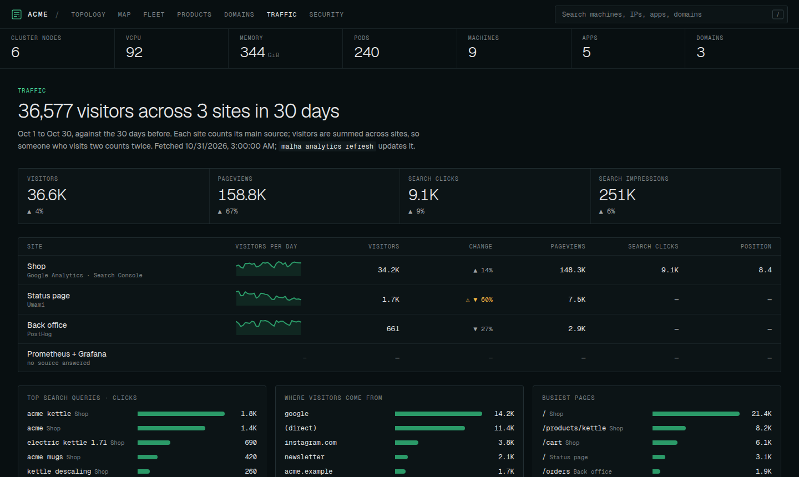

# Traffic

Every site's visitors and search traffic in one place: Umami, Google Analytics 4, PostHog and Google Search Console, read by plugins and shown in the Traffic tab, next to the machines and apps they run on.



```bash
malha plugin add umami infra/topology.yaml     # and/or google, posthog
malha analytics detect infra/topology.yaml     # which app loads which tracker; review the diff
malha analytics refresh infra/topology.yaml    # fetch the last 30 days (--days 1 … 365)
malha analytics infra/topology.yaml            # the same table in the terminal
malha dev infra/topology.yaml                  # the Traffic tab; refreshes itself every 6 hours
```

## How it fits together

Each app lists where its traffic is measured:

```yaml
apps:
  - id: shop
    domains: [acme.example, www.acme.example]
    analytics:
      - { provider: ga4, id: "312345678" }                       # GA4 property id
      - { provider: search-console, id: "sc-domain:acme.example" }
  - id: status
    analytics:
      - { provider: umami, id: 7b8f1c2e-5a44-4d1e-9c3a-2f6e8d0b1a55 }   # Umami website id
  - id: admin
    analytics:
      - { provider: posthog, id: 4242, host: "https://eu.posthog.com" } # PostHog project id
```

These ids are not secrets: they are in every page's source. Credentials never go in the file.

- **`malha analytics detect`** loads the home page of each site an app serves (one per domain, so whitelabels count), and the scripts it loads from its own origin, and picks out tracker ids: Umami website ids, GA4 measurement ids (`G-…`), Tag Manager containers, PostHog project keys. Each analytics plugin then matches them to its sources (a GA4 measurement id to its property, a PostHog key to its project), and Search Console properties to the app that owns each domain. You review the proposed `analytics` entries as a diff. Malha itself does the page loading, and only ever requests the apps' own pages.
- **`malha analytics refresh`** asks each plugin for its sources' numbers over whole days ending yesterday, and the same number of days before, and writes `.malha/analytics.json`. Plugins are untrusted: Malha keeps only the sources it asked for, and well-formed numbers.
- **The Traffic tab** reads that file. `malha dev` refreshes it when it is older than 6 hours, asking in the page for anything not approved yet; `malha build` embeds it (`--no-analytics` leaves it out).

## Setting up each provider

Each plugin asks before it reads a credential or calls an API, like every Malha plugin. To approve one ahead of time (for a timer or CI): `malha plugin allow <name> infra/topology.yaml`.

### Umami (cloud or self-hosted)

```json
"umami": { "source": "builtin:umami", "options": { "hosts": ["https://umami.acme.example"] } }
```

`hosts` lists your Umami servers, or `https://api.umami.is` for Umami Cloud. The plugin may call only those hosts, and you approve each one by name.

| Server | Credentials |
| --- | --- |
| Umami Cloud | An API key from Settings → API keys: `UMAMI_API_KEY`. |
| Your own | A user that can view the websites: `UMAMI_USERNAME` and `UMAMI_PASSWORD`. |
| Several | `~/.config/malha/umami.json`: `{ "https://umami.acme.example": { "username": "…", "password": "…" }, "https://api.umami.is": { "apiKey": "…" } }` |

Works with Umami 2 and 3.

### Google Analytics 4 and Search Console

One plugin, one credential: a service account.

1. In Google Cloud, create a service account (no roles needed) and a JSON key for it. Turn on the **Google Analytics Data API**, the **Google Analytics Admin API** and the **Google Search Console API** for that project.
2. In Google Analytics, add the service account's email to each property, as **Viewer**.
3. In Search Console, add it to each property as a **Restricted** user.
4. Put the JSON key in `~/.config/malha/google-service-account.json`, or its contents in `GOOGLE_SERVICE_ACCOUNT` (for CI).

The plugin signs its own token with the key and asks only for read-only scopes (`analytics.readonly`, `webmasters.readonly`). Search Console data trails by two or three days, so the last days of a range are low.

### PostHog (cloud or self-hosted)

```json
"posthog": { "source": "builtin:posthog", "options": { "hosts": ["https://us.posthog.com"] } }
```

`hosts` is `https://us.posthog.com` or `https://eu.posthog.com` for PostHog Cloud, or your instance. Create a personal API key (Settings → Personal API keys) with read access to **Organization**, **Project** and **Query**, and access to every organization your sites are in, and put it in `POSTHOG_PERSONAL_API_KEY` or `~/.config/malha/posthog-key`.

Sites under separate PostHog accounts take one key each: one per line in `~/.config/malha/posthog-key`, each optionally followed by `# a label` that messages use instead of the key (or comma-separated in the variable). Each project is read with whichever key can see it.

One PostHog project often collects several sites, so the plugin counts only `$pageview` events whose host is one of the app's `domains` (`*.acme.example` matches every subdomain).

## What the numbers mean

| | Umami | GA4 | PostHog |
| --- | --- | --- | --- |
| Visitors | visitors | active users | distinct persons |
| Pageviews | pageviews | screen and page views | `$pageview` events |
| Sessions | visits | sessions | distinct `$session_id`s |

Each provider counts its own way, so compare a site with itself over time rather than one provider with another. An app's numbers come from one provider: that of the source marked `primary: true`, or else of its first source that is not Search Console. Every source of that provider is added up, since each usually measures another of the app's sites (a whitelabel with its own PostHog project or GA4 property); the app panel lists them. Sources of other providers are left out of the app's numbers, since they count the same visits again. The headline total adds up each app's visitors, so someone who visits two sites counts twice.

`malha analytics refresh` also says when the numbers may be short:

- **Not counted:** pageviews on hostnames no app lists (PostHog). Add the hostname to the right app's `domains`.
- **No pageviews:** a PostHog project with no `$pageview` events, and what it does collect. Usually `capture_pageview: false` in posthog-js.

## Checks

`malha check` reads the last refresh too: a site whose visitors fell by half against the previous period, or by four fifths, or that had none at all for two days (a tracker removed in a deploy, or a site down); search clicks that fell by half; sources that failed; and traffic data older than three days. `malha check --notify` posts them like any other finding. See [checks.md](checks.md).

## Privacy

Only aggregates leave the providers: counts per day, and the top pages, referrers, countries, devices and search queries. They stay in `.malha/analytics.json`, which is never committed. A `malha build` with traffic inside is as private as the numbers: host it behind authentication.
